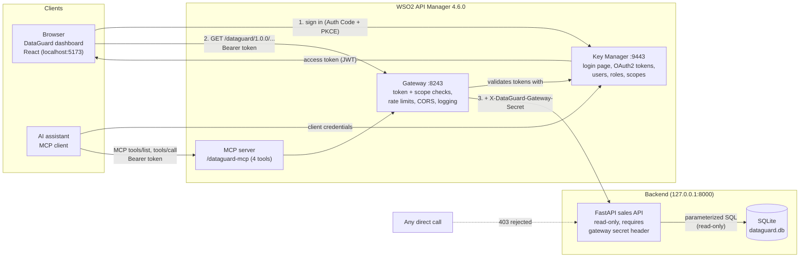

# DataGuard

**Governed data access for people and AI agents**

DataGuard lets an online retailer's managers, analysts and AI assistants answer
sales questions themselves, without anyone getting direct database access.
Every request, from a person in the web dashboard or an AI assistant using MCP
tools, passes through **WSO2 API Manager 4.6.0**, which handles sign-in,
role-based permissions, rate limits and logging. Without API Manager there is
no access at all.

Built as a portfolio project for a WSO2 internship application: *"Use a WSO2
product in a real-world project or solution."*

---

## The problem

A small online retailer has two years of sales data. Managers want to look up
customers, analysts want trends and best sellers, and the team wants AI
assistants to answer questions too. But:

- the data includes **personal data** (customer history) that only managers
  should see;
- direct database access can't be limited, audited or rate-limited;
- an **AI agent** can make thousands of calls without anyone noticing.

## The solution

| Need | How DataGuard meets it |
|---|---|
| One controlled way in | A read-only sales API published through the WSO2 gateway; the backend rejects anything that didn't come through it |
| Sign-in without sharing passwords | OAuth2 Authorization Code + PKCE on WSO2's own login page |
| Role-based access | Scopes `sales:read` (analyst, manager) and `customer:read` (manager only), enforced by the gateway |
| Fair use | Separate rate limits for the dashboard (30/min per user) and AI agents (10/min) |
| Safe AI access | An MCP server generated by API Manager's MCP Gateway, exposing only aggregate sales tools, no customer tool |
| Audit | Every call goes through the gateway and is logged by API Manager |

## Screenshots

> Placeholders, to be replaced with recordings from the demo (save files in
> `docs/screenshots/`).

| Screen | File |
|---|---|
| Sign-in page | `docs/screenshots/signin.png` |
| WSO2 login page | `docs/screenshots/wso2-login.png` |
| Overview (KPIs and monthly chart) | `docs/screenshots/overview.png` |
| Products | `docs/screenshots/products.png` |
| Countries | `docs/screenshots/countries.png` |
| Analyst: "Access denied by WSO2 API Manager (403)" | `docs/screenshots/customers-analyst-403.png` |
| Manager: customer summary | `docs/screenshots/customers-manager.png` |
| Rate limited: "Too many requests, limited by WSO2" | `docs/screenshots/rate-limited.png` |
| Access & Security page | `docs/screenshots/access.png` |
| Mobile, dark theme | `docs/screenshots/mobile-dark.png` |
| AI assistant using the MCP tools | `docs/screenshots/mcp-assistant.png` |
| API Manager Publisher: API and MCP server | `docs/screenshots/publisher.png` |

## Architecture



## How each WSO2 feature is used, and why it matters

| WSO2 feature | Used for | Why it matters |
|---|---|---|
| **Publisher REST API v4** | Creates the API from the backend's OpenAPI spec, sets scopes, CORS and policies, deploys revisions, publishes | The whole setup is code: repeatable and reviewable |
| **OAuth2 / Key Manager** | Login page, Authorization Code + PKCE for the dashboard, client credentials for the AI agent | Users never give their password to the app; tokens expire after an hour |
| **Scopes bound to roles** | `sales:read` for analysts and managers, `customer:read` for managers only | Personal data is protected at the gateway, not by hiding UI elements |
| **Application rate-limit policies (Admin API v4)** | `DataGuardDashboard` 30/min per user, `DataGuardAIAgent` 10/min | Stops runaway scripts and AI loops from overloading the service |
| **API-level CORS** | Only `http://localhost:5173` may call the API from a browser | Other websites can't use a signed-in user's browser to read data |
| **Operation policy `addHeader`** | The gateway adds a shared secret to every backend call | Makes the gateway the only way in, even for programs on the same machine |
| **Applications and subscriptions (Developer Portal API v3)** | "Dashboard" (PKCE public client) and "AI Agent" apps, each with its own policy | Different clients get different credentials, limits and audit trails |
| **MCP Gateway** | MCP server generated from the existing API with four tools | AI assistants get governed, documented tools instead of database access |
| **Dynamic Client Registration** | The setup scripts obtain their admin token | Standard, scriptable access to the management APIs |
| **Gateway logs** | Every request through port 8243 is logged by API Manager | An audit trail for people and AI alike |

## Tech stack

- **WSO2 API Manager 4.6.0**: gateway, key manager, Publisher, Developer Portal, MCP Gateway
- **Backend:** Python 3.13, FastAPI, Uvicorn, SQLite, pandas (data pipeline)
- **Frontend:** React 19, TypeScript 7, Vite 8, Tailwind CSS 3.4, Recharts 3, React Router 7
- **Testing:** pytest, Vitest + React Testing Library, Playwright (live UI), a live security test script
- **Lint:** oxlint (React, jsx-a11y, import and vitest plugins)

## Project layout

```
backend/            clean.py (data pipeline), app/ (FastAPI), tests/
frontend/           React dashboard, src/test (unit tests), e2e/ (live UI tests)
wso2/               openapi.json (exported spec), scripts/ (API Manager automation)
scripts/            start_*.cmd, security_tests.py, wso2_auth.py, get_agent_token.py
notebooks/          explore.py (data exploration)
docs/               decisions, learning guide, demo script, manual steps, data quality
data/               dataset and SQLite database (git-ignored)
```

## Run it from scratch (Windows, Command Prompt)

**Prerequisites:** Python 3.13, Node.js LTS, Java 17 (`JAVA_HOME` set), WSO2 API
Manager 4.6.0 unzipped at `C:\wso2am-4.6.0`, and the dataset
`online_retail_II.xlsx` in `data\` ([download from UCI](https://archive.ics.uci.edu/dataset/502/online+retail+ii)).

```cmd
cd C:\dataguard

:: 1. Python environment
python -m venv venv
venv\Scripts\activate
pip install -r requirements.txt

:: 2. Build the database (about 90 seconds)
python backend\clean.py

:: 3. Secrets and test-user passwords (writes .env, never committed)
python wso2\scripts\generate_env.py

:: 4. Start API Manager and wait for "WSO2 Carbon started" (about 3 minutes)
start "WSO2 API Manager" /d C:\wso2am-4.6.0\bin api-manager.bat

:: 5. Configure API Manager (safe to re-run any time)
python wso2\scripts\setup_all.py

:: 6. Frontend packages
cd frontend && npm install && cd ..
```

Then accept the local certificate in your browser once (see
[docs/manual-steps.md](docs/manual-steps.md), step 1).

**Every day after that:** `scripts\start_all.cmd` starts API Manager, waits
until it answers, then opens the backend and the dashboard in their own windows.
To start parts separately: `scripts\start_backend.cmd`,
`scripts\start_frontend.cmd`. Open <http://localhost:5173>.

**Test users:** `analyst1` (role analyst) and `manager1` (role manager).
Their passwords are in `.env` (`ANALYST1_PASSWORD`, `MANAGER1_PASSWORD`).

**Stopping:** press Ctrl+C in the backend and dashboard windows, and in the API
Manager window (or close it).

> **Local development only:** API Manager uses a self-signed certificate, so
> the setup and test scripts turn off TLS certificate verification and the
> Vite proxy uses `secure: false`. Never do this against a real server.

## Tests

```cmd
:: Backend (58 tests)
venv\Scripts\python -m pytest

:: Frontend unit tests (31), lint and production build
cd frontend
npm test
npm run lint
npm run build

:: Live UI tests: real WSO2 sign-in in Microsoft Edge (stack must be running)
npm run e2e
cd ..

:: Live security tests against the running gateway
venv\Scripts\python scripts\security_tests.py
```

### Security test results (live run, 28 October 2026)

| Check | Expected | Actual | Result |
|---|---|---|---|
| No token -> rejected | 401 | 401 | PASS |
| Analyst token on /customers/{id}/summary | 403 (scope check) | 403 900910 | PASS |
| Manager token on /customers/{id}/summary | 200 with data | 200 | PASS |
| Analyst token on /sales/summary | 200 with data | 200 | PASS |
| AI Agent asks for customer:read | only sales:read granted | sales:read | PASS |
| Direct backend call without the secret | 403 (and 403 with a wrong one) | 403 / 403 | PASS |
| CORS preflight from the dashboard origin | allowed (http://localhost:5173) | http://localhost:5173 | PASS |
| CORS preflight from an unknown origin | blocked (origin not echoed) | (none) | PASS |
| MCP server lists only allowed tools | 4 tools, no customer tool | getMonthlySales, getRevenueByCountry, getSalesSummary, getTopProducts | PASS |
| Burst of requests from the AI Agent app | 429 after the 10/min limit | 429 after 12 OK | PASS |

Limits are counted in fixed one-minute windows, so a burst that crosses a window
boundary can get a couple of extra requests through before the 429 (runs during
the build saw 10, 12 and 17).

## Dataset

**Online Retail II**, Daqing Chen, UCI Machine Learning Repository,
<https://doi.org/10.24432/C5CG6D>, licensed under
[Creative Commons Attribution 4.0 (CC BY 4.0)](https://creativecommons.org/licenses/by/4.0/).
All transactions of a UK-based online gift retailer between 1 December 2009 and
9 December 2011. The data was cleaned for this project (see
[docs/data-quality.md](docs/data-quality.md)); the dataset itself is not
included in this repository.

## Why SQLite

The data is a fixed history (about a million rows), the API only reads, and
everything has to run on one laptop. SQLite needs no server, opens in read-only
mode so no endpoint can ever write, and answers every query well within a
second or two thanks to indexes on date, customer and country. A shared,
multi-writer deployment would move to PostgreSQL (see future work).

## How AI was used

This project was built with **Claude Code** (Anthropic's coding assistant),
working from a detailed brief I wrote: the problem, required features, rules
and a definition of done. Claude Code wrote the code, scripts, tests and
documentation, checked API Manager 4.6.0 behaviour against the product's own
REST API definitions and the live server, and ran every test. Along the way it
found and fixed a real issue (WSO2 dropping scope bindings when an API
definition was re-imported; see [docs/decisions.md](docs/decisions.md) 5a).
I reviewed the work and studied how every part fits together;
[docs/LEARNING.md](docs/LEARNING.md) is the walkthrough I use to explain it.

## Limitations

- Runs locally only, with API Manager's self-signed certificate and the
  out-of-the-box `admin/admin` account.
- The gateway-to-backend shared secret is visible to API Manager publishers
  and travels over plain HTTP on the loopback interface (see decisions.md #4).
- The PKCE token exchange goes through the Vite dev server because API
  Manager's token endpoint sends no CORS headers by default (decisions.md #10);
  the dashboard is not meant to be deployed as static files as-is.
- The dashboard shows a user ID instead of a username unless the optional
  claim step in manual-steps.md is done.
- Rate limiting counts in fixed one-minute windows, so a burst crossing a
  minute boundary can briefly exceed the nominal limit.
- In API Manager 4.6.0, calling a tool name that doesn't exist returns a 500
  fault instead of a JSON-RPC error (no data is exposed).
- AI agent tokens last one hour and must be refreshed by hand for MCP clients.
- Cancellations are kept in their own table rather than netted against the
  sales they reverse (as specified), so two large orders that were cancelled
  minutes later still count as sales and appear in the top products (see
  [docs/data-quality.md](docs/data-quality.md)).
- The dataset is historical (2009 to 2011), so figures don't change.

## Future work

- **Docker** images and a compose file for the whole stack
- **Cloud deployment** with real certificates and a managed gateway
- **PostgreSQL** instead of SQLite for multi-user, multi-writer use
- **WSO2 Identity Server** as an external key manager (MFA, user self-service,
  richer claims such as usernames in tokens)
- **API Manager 4.7.0** upgrade
- Mutual TLS or backend JWT validation instead of the shared secret
- API Manager analytics dashboards for usage and AI-agent behaviour

## Documentation

- [docs/decisions.md](docs/decisions.md): every important decision and why
- [docs/LEARNING.md](docs/LEARNING.md): how the system works, step by step, with interview questions
- [docs/demo-script.md](docs/demo-script.md): 5-minute demo video script
- [docs/manual-steps.md](docs/manual-steps.md): what you do by hand (certificates, AI assistant)
- [docs/data-quality.md](docs/data-quality.md): before/after row counts and cleaning rules

## Publishing to GitHub

Nothing has been pushed and no remote is configured. When ready, create an
empty repository on GitHub (no README or licence), then:

```cmd
cd C:\dataguard
git status
git branch -M main
git remote add origin https://github.com/<your-username>/dataguard.git
git push -u origin main
```
